# Self-Hosted Pulumi on AWS ECS Fargate - TypeScript

This Pulumi program deploys the Pulumi API and UI in AWS using ECS Fargate

> ⚠️ Before proceeding, please take the provided installation code and commit it **as-is** to your own source control. As you make changes or customize it, please commit these to your repo as well. This will help keep track of customizations and updates.

> ℹ️ You will likely want to use one of the [Self-Managed Backends](https://www.pulumi.com/docs/intro/concepts/state/#logging-into-a-self-managed-backend) as the state storage for this installer. Please document this (in the repo your store this code, an internal wiki, etc) so that future updates will be straightforward for you and your colleagues.

## Revision History

Version ID | Date | Note
---|---|---
1 | 01/22/2022 | DNS project added; Route53 A records are contained in a separate project to allow a different AWS account to be used, if needed.
2 | 05/03/2022 | README.md split into Golang and TypeScript specific versions
3 | 01/20/2023 | MySQL 8 support
4 | 07/25/2024 | Pulumi [Resource Search](https://www.pulumi.com/blog/self-hosted-search-and-deploy/) now available in Self-Hosted. Resource Search is enabled by setting the `enableOpenSearch` flag in the Infrastructure project. Note, other configuration values, all prefixed OpenSearch are availble. 
5 | 07/30/2024 | Use of Stack References removed in favor of Stack Configuration. 
6 | 10/15/2024 | Add ESC deployment to the installer.
7 | 03/09/2026 | Add support for new env vars to enable V2 DB schema, and additional changes to bring installer up to date. **DO NOT USE THIS VERSION OF THE INSTALLER FOR AN EXISTING INSTALL. CONTACT PULUMI SUPPORT TO MIGRATE THE DB FIRST.**
8 | 09/14/2026 | OpenSearch domain moved from 2.13 to 3.7. Existing installs must step the domain up through 2.19 out of band before running this version - see the OpenSearch upgrade section below.
9 | 11/16/2026 | Opt-in private (internal-only) mode via `enablePrivateLoadBalancerAndLimitEgress` in all three projects, see [Private (internal-only) deployment](#private-internal-only-deployment). Off by default; existing installs are unchanged. The application project now also reads the documented `consoleDesiredNumberTasks` key (the misspelled `consoleDesirecNumberTasks` still works) and supports an optional `imagePrefix` for ECR pull-through caches. Fix: the OpenSearch master password now always contains an uppercase letter, a lowercase letter, a number and a special character (new installs could fail `CreateDomain`); existing passwords are kept.

## User Guides

- [Self-Hosted Pulumi Service][self-hosted-pulumi-user-guide]
- [Pulumi API Service][pulumi-api-service-user-guide]
- [Pulumi Console Service][pulumi-console-service-user-guide]

## Prerequisites 

- [Get Started with Pulumi and AWS][get-started-aws].
- AWS Access Environment Variables:
  - Set AWS_ACCESS_KEY_ID and AWS_SECRET_ACCESS_KEY and AWS_SESSION_TOKEN (if using temporary tokens) as environment variables.
- [S3 State Backend][s3-backend]
  - Set AWS_PROFILE to your AWS profile of choice as defined in ~/.aws/config
  - Set PULUMI_CONFIG_PASSPHRASE to some secret passphrase for handling secrets.
- [ECR][ecr] repositories which contain Pulumi API (service), Pulumi UI (console), and Pulumi Migration images. NOTE: the below `imageTag` configuration value corresponds to image tag in each ECR repo. Also, by default this program expects the ECR repos to be named after the Pulumi containers. Eg- `pulumi/service`, `pulumi/console`, `pulumi/migrations`.
- [VPC][vpc]
  - At least two public subnet available. Not needed in [private mode](#private-internal-only-deployment).
  - At least two private subnet available.
  - At least two isolated subnet available. In this case as `isolated` subnet is one which can only be connected to or from other instances in the same subnet. They do not route traffic to the internet, therefore, they do not require NAT gateways.
- [ACM][acm] certificate that covers the base domain (eg- example.com) and also the subdomain, if one is being utilized (eg- sub.example.com). Lastly, the certificate must cover `app.{sub}.example.com` and `api.{sub}.example.com`. Note: `sub` is optional in this case.
- [Route53][route53] hosted zone which conincides with the above ACM certificate.
- [KMS][kms] key to be used by Pulumi service for encryption/decryption purposes.

## Services Used

- [ECS][ecs] - Managed ECS Cluster.
- [Fargate][fargate] - Managed Container Service.
- [RDS Aurora][rds] - Managed MySQL DB for persistent state, with automated
  replication and snapshotting.
- [S3][s3] - Object storage for checkpoints and policy packs.
- [CloudWatch Logs][cloudwatch-logs] - Centralized logging for all cluster pods.
- [Route53][r53] - Managed DNS records.
- [NLB][nlb] - Managed L4 / application traffic and SSL termination.
- [ACM][acm] - Managed public TLS certificates.
- [OpenSearch][OpenSearch] - Managed OpenSearch

## Architecture

1. [base-insfrastructure](./infrastructure)

    Aurora DB, VPC Endpoints, EC2 Security Groups

1. [application-infrastructure](./application)

    Deploy ECS Clusters and Services to run the Pulumi API and Pulumi UI

1. [dns-infrastructure](./dns)

    Deploy Route 53 A Records for the Pulumi API and Pulumi UI

The architecture is split up by functional responsibilities in separate
Pulumi projects to decouple the database, its required services, and the Pulumi service from each other.

### Design Considerations

The Pulumi services operate in AWS Elastic Container Service (ECS) with the following app properties.

- **Stateless**: Uses RDS and S3 for state management, which allows for rolling updates
  of the API and Console to occur with ease.
- **Highly-Scalable**: API and Console services are configured to scale up or down on CPU and Memory metrics. 
  This ensure the Pulumi services will elastically respond to the needs of your users.
- **Highly-Available**: API and Console services are configured to be deployed across multiple 
  availability zones ensuring redudancy in your applications. RDS Database can also be configured with multiple replicas, across different availability zones.

## Install

**WARNING**  
Be sure you have set up and created all the items in [Prerequisites](prerequisites).

1. Clone the repo and install dependencies:

```bash
git clone https://github.com/pulumi/pulumi-self-hosted-installers.git
cd ecs-hosted/{ts|go}
```

2. Login to your [Self-Managed Backend](https://www.pulumi.com/docs/intro/concepts/state/#logging-into-a-self-managed-backend).

```bash
pulumi login s3://<bucket-name>
```

3. Navigate to `infrastructure` directory to initialize, configure, and deploy the base infrastructure resources required.

```bash
cd infrastructure
npm install
pulumi stack init # follow prompt
```

### Required Configuration

```bash
aws:region - AWS Region
vpcId - Valid, pre-existing AWS VPC 
publicSubnetIds - At least two subnet ID. Optional when enablePrivateLoadBalancerAndLimitEgress is true.
privateSubnetIds - At least two private subnet ID
isolatedSubnetIds - At least two isolated subnet ID
```

### Optional Configuration

```bash
commonName - Prefix for resource names (default is pulumiselfhosted)
numberDbReplicas - Number of Aurora read replicas, 0 to 2 (default is 0)
dbInstanceType - RDS Database Instance Type (default is db.t3.medium)
enableOpenSearch - Deploys an AWS OpenSearch Domain as part of the project
openSearchInstanceType - AWS OpenSearch Instance Type (default is t3.medium.search)
openSearchInstanceCount - AWS OpenSearch Instance Count (default is 2; must be at least the number of privateSubnetIds)
openSearchDomainName - AWS OpenSearch Domain Name (default is pulumi)
openSearchDedicatedMasterCount - AWS OpenSearch Dedicated Master Count (default is no dedicated master nodes)
enableVpcEndpoints - Create the VPC endpoints listed below (default is true)
enablePrivateLoadBalancerAndLimitEgress - Private (internal-only) mode, default is false. See "VPC Endpoints" below and
    "Private (internal-only) deployment".
```

**Note: below configuration values are examples. Provide your own.**

### Set Configuration Values

```bash
pulumi config set aws:region us-west-2
pulumi config set vpcId vpc-12345789
pulumi config set publicSubnetIds '[ "subnet-03fd1ba00d1ff893c","subnet-09a443b2aece32800","subnet-0f89dff186bdd1f56"]'
pulumi config set privateSubnetIds '["subnet-0323d9d5445d31651","subnet-0e82d2298e8742481","subnet-07ffe683886112c56"]'
pulumi config set isolatedSubnetIds '[ "subnet-03fd1ba00d1ff893c","subnet-09a443b2aece32800","subnet-0f89dff186bdd1f56"]'
```

Optionally, configure the DB Instance Type of your choice.

### VPC Endpoints

With `enableVpcEndpoints` (the default) this stage creates an S3 gateway endpoint and interface endpoints with private
DNS in the private subnets for `ecr.api`, `ecr.dkr`, `secretsmanager` and `ssm`.

With `enablePrivateLoadBalancerAndLimitEgress` also set, it additionally:

- associates the S3 gateway endpoint with the route tables of the private and isolated subnets (the VPC main route
  table for subnets without an explicit association)
- creates `kms` and `logs` interface endpoints

If the VPC already has any of these endpoints, or already resolves these service names privately (for example through
centrally shared endpoints), creating them fails on the private DNS conflict. Set `enableVpcEndpoints` to `false` in
that case and make sure the VPC provides, for the private subnets:

- interface endpoints with private DNS for `kms`, `ecr.api`, `ecr.dkr`, `logs` and `secretsmanager`, plus `sts` if the
  service has to assume AWS roles (for example ESC `aws-login`), with security groups that allow 443 from the VPC
- an S3 gateway endpoint associated with the route tables of the private subnets (and the isolated subnets)

Switching an existing install to `enableVpcEndpoints=false` deletes the endpoints this stage created.

### Deploy

```bash
pulumi up
```

Review the resources to be created, if necessary, and select YES or NO. Upon completion of the deployment, information required by the application project, will be outputted the base infrastructure project.

4. Navigate to the `application` directory, to initialize, configure, and deploy the application infrastructure resources required.

```bash
cd ../application
npm install
pulumi stack init # follow prompt
```

### Required Configuration

```bash
aws:region - AWS Region
vpcId - Valid, pre-existing AWS VPC 
publicSubnetIds - At least two subnet ID. Not required when enablePrivateLoadBalancerAndLimitEgress is true.
privateSubnetIds - At least two private subnet ID
dbClusterEndpoint - RDS Cluster Endpoint hostname (infrastructure output dbClusterEndpoint)
dbPort - MySQL Port
dbName - Database Name
dbSecurityGroupId - Database Security Group ID
dbUsername - Database Username for Pulumi Cloud
dbPassword - Database Password for Pulumi Cloud
endpointSecurityGroupId - Endpoint Security Group ID for VPC Endpoints (infrastructure output). Not read by the program;
    not required when enablePrivateLoadBalancerAndLimitEgress is true.
imageTag - Specific Pulumi docker container image tag to be used for deployment. Note: Existing ECR repo w/ Pulumi images (api, ui, migrations) is required.
domainName - Route 53 Hosted Zone Name of zone to be used for DNS records.
acmCertificateArn - ACM Certificate ARN that covers the Route 53 Hosted Domain.
kmsServiceKeyId - KMS Key Id of KMS Key that will be used to secure secrets. Note: AWS user performing update will require access to modify key's IAM policy.
licenseKey - Valid license key to host Pulumi Self-Hosted (Contact Sales to obtain).
```

### Optional Configuration

```bash
subDomain - Subdomain to be used for DNS records Eg- sub-domain.hosted-zone-domain.com. Default is none.
isolatedSubnetIds - Isolated subnet IDs. Not used by this project.
ecrRepoAccountId - AWS account that holds the ECR repos, if not the current account.
imagePrefix - Repository prefix in front of pulumi/<image>, eg- docker-hub for an ECR pull-through cache rule with that
    prefix. A trailing "/" is added if missing. Default is none. See "ECR pull-through cache".
ecrPullThroughCacheImport - Grant the task execution roles the permissions to import images through the pull-through
    cache on first pull. Requires imagePrefix. Default is false.

apiDesiredNumberTasks - Desired number of ECS tasks for the API. Default is 1.
apiTaskMemory - ECS Task level Memory. Default is 1024 MiB.
apiTaskCpu - ECS Task level CPU. Default is 512 CPU units.
apiContainerCpu - CPU alloted to the Pulumi API Container. Defaults to Task CPU amount.
apiContainerMemoryReservation - Memory reserved for the Pulumi API Container. Default is 384 MiB.
apiDisableEmailLogin - See PULUMI_DISABLE_EMAIL_LOGIN api env variable.
apiDisableEmailSignUp - See PULUMI_DISABLE_EMAIL_SIGNUP api env variable.
apiEngineEventsSchemaV2 - See PULUMI_ENGINE_EVENTS_SCHEMA_V2 api env variable. Default is true.
apiEngineEventsLegacyWrite - See PULUMI_ENGINE_EVENTS_LEGACY_WRITE api env variable. Default is false.

opensearchUser - AWS OpenSearch User for Pulumi Cloud (infrastructure output opensearchUser)
opensearchPassword - AWS OpenSearch Password for Pulumi Cloud (infrastructure output opensearchPassword)
opensearchEndpoint - AWS OpenSearch Endpoint for Pulumi Cloud (infrastructure output opensearchEndpoint)
opensearchDomainName - AWS OpenSearch Domain for Pulumi Cloud (infrastructure output opensearchDomainName)

consoleDesiredNumberTasks - Desired number of ECS tasks for the UI. Default is 1. The older misspelled key
    consoleDesirecNumberTasks is still read when this one is not set.
consoleTaskMemory - ECS Task level Memory. Default is 512 MiB.
consoleTaskCpu - ECS Task level CPU. Default is 256 CPU units.
consoleContainerCpu - CPU alloted to the Pulumi UI Container. Defaults to Task CPU amount.
consoleContainerMemoryReservation - Memory reserved for the Pulumi UI Container. Default is 128 MiB.
consoleHideEmailLogin - See PULUMI_HIDE_EMAIL_LOGIN UI env variable.
consoleHideEmailSignup - See PULUMI_HIDE_EMAIL_SIGNUP UI env variable.
agGridLicenseKey - AG Grid license key for the UI (secret).

recaptchaSiteKey - reCAPTCHA site key for the UI.
recaptchaSecretKey - reCAPTCHA secret key for the API (secret).
samlCertPublicKey - SAML SSO certificate public key (secret).
samlCertPrivateKey - SAML SSO certificate private key (secret). Setting it enables SAML SSO in the UI.

smtpServer - Address of SMTP server as host:port.
smtpUsername - SMTP username.
smtpPassword - SMTP password.
smtpGenericSender - Email to be used for sending emails from Pulumi API.

logType - Type of logs to be used. Default is awslogs. See Logging section below.
logArgs - Arguments provided to log configuration. Only read when logType is set. See Logging section below.

whiteListCidrBlocks - List of CIDRs allowed to reach both load balancers on 80/443. Default is 0.0.0.0/0, or the VPC
    CIDR blocks in private mode.

enablePrivateLoadBalancerAndLimitEgress - Private (internal-only) mode, default is false. See "Private (internal-only)
    deployment".
s3EndpointPrefixId - S3 gateway endpoint prefix list (infrastructure output). Private mode only; looked up by name
    (com.amazonaws.<region>.s3) when unset.
httpsProxy - HTTP proxy URL for the API's outbound internet calls, eg- http://proxy.internal:3128. Sets HTTPS_PROXY and
    HTTP_PROXY on the API container.
noProxy - List of extra NO_PROXY entries for the API container. See "Outbound proxy".
```

**Note: below configuration values are examples. Provide your own.**
### Set Configuration Values

```bash
pulumi config set aws:region us-west-2
pulumi config set imageTag 20220105-189-signed
pulumi config set acmCertificateArn arn:aws:acm:us-west-2:052848974346:certificate/ee6d246c-dd3a-4667-b58a-4568a0f72dd6
pulumi config set kmsServiceKeyId f7f56e09-f568-447c-8540-cef8ba122a79
pulumi config set licenseKey {value} --secret
pulumi config set agGridLicenseKey {agGridLicenseKey} --secret
pulumi config set logType awslogs
pulumi config set logArgs '{"name": "pulumi-selfhosted", "retentionInDays": 3}'
pulumi config set vpcId vpc-12345789
pulumi config set privateSubnetIds '[ "subnet-03fd1ba00d1ff893c","subnet-09a443b2aece32800","subnet-0f89dff186bdd1f56"]'
pulumi config set publicSubnetIds '["subnet-0323d9d5445d31651","subnet-0e82d2298e8742481","subnet-07ffe683886112c56"]'
pulumi config set dbClusterEndpoint pulumiselfhosted.cluster-abc123.us-west-2.rds.amazonaws.com
pulumi config set dbPort 3306
pulumi config set dbName pulumi
pulumi config set dbSecurityGroupId sg-12345
pulumi config set dbUsername pulumi
pulumi config set dbPassword {db-password} --secret
pulumi config set endpointSecurityGroupId sg-1234
pulumi config set subDomain my-sub-domain
pulumi config set domainName hosted-zone.com
pulumi config set smtpGenericSender email@email.com
pulumi config set smtpPassword {some-password} --secret
pulumi config set smtpServer email-smtp.us-west-2.amazonaws.com:587
```

### ECR pull-through cache

By default the images are `<account>.dkr.ecr.<region>.amazonaws.com/pulumi/{service,console,migrations}:<imageTag>`,
where `<account>` is `ecrRepoAccountId` or the current account. An ECR pull-through cache rule serves upstream images
under its prefix instead, for example `docker-hub/pulumi/service:<tag>` for a rule with prefix `docker-hub` and Docker
Hub as upstream. Set the prefix with:

```bash
pulumi config set imagePrefix docker-hub
# images: <account>.dkr.ecr.<region>.amazonaws.com/docker-hub/pulumi/service:<imageTag>, .../docker-hub/pulumi/console:...
```

`docker-hub`, `docker-hub/` and `/docker-hub/` are equivalent. (The Go installer prepends `imagePrefix` verbatim, so
there it needs the trailing `/`; with `docker-hub/` both installers build the same URIs.)

The first pull of an image through the cache imports it and creates its repository, which needs
`ecr:BatchImportUpstreamImage` and `ecr:CreateRepository`. The task execution roles this installer creates do not have
them (only `AmazonECSTaskExecutionRolePolicy`). Either pull each image once beforehand with a principal that has these
permissions, for example `docker pull <account>.dkr.ecr.<region>.amazonaws.com/docker-hub/pulumi/service:<imageTag>`
after `aws ecr get-login-password`, or set `ecrPullThroughCacheImport` to `true`. That grants the two permissions to the
API, console and migrations execution roles, scoped to `repository/<imagePrefix>pulumi/*` in the registry account.
With `ecrRepoAccountId` pointing at another account, that registry must also allow this account.

ECR fetches from the upstream registry itself, so the cache also works in [private mode](#private-internal-only-deployment)
without internet egress from the VPC.

### Deploy

```bash
pulumi up
```
Review the resources to be created, if necessary, and select YES or NO. Upon completion of the deployment, information required by the application project, will be retrieved as Stack References from the infrastructure project.

The `application` project generates the RSA signing keys for the API's two OIDC issuers and passes them to the API,
through Secrets Manager, as `OIDC_KEYS` (v1 issuer at `/oidc`) and `OIDC_KEYS_V2` (v2 issuer at `/oidc/v2`). The keys
are protected resources: replacing one rotates that issuer's signing key, and tokens already signed with the old key
stop verifying. Run `pulumi state unprotect --all` before destroying the project.
On an existing install, the first deploy with this version also switches the v1 issuer from the key the service stored
in its database to the generated key, with the same effect.

5. Navigate to the `dns` directory initialize and create the route53 A records for the Pulumi API and Pulumi UI

```bash
cd dns
npm install
pulumi stack init # follow prompt
```

### Required Configuration

```bash
aws:region - AWS region
route53ZoneName - Route 53 Zone Name (application output route53ZoneName)
route53Subdomain - Subdomain (application output route53Subdomain); may be set to an empty string
apiLoadBalancerDnsName - DNS name of the API load balancer (application output apiLoadBalancerDnsName)
apiLoadBalancerZoneId - Hosted zone ID of the API load balancer (application output apiLoadBalancerZoneId)
consoleLoadBalancerDnsName - DNS name of the Console load balancer (application output consoleLoadBalancerDnsName)
consoleLoadBalancerZoneId - Hosted zone ID of the Console load balancer (application output consoleLoadBalancerZoneId)
```

### Optional Configuration

```bash
enablePrivateLoadBalancerAndLimitEgress - Private mode, default is false: create the records in a Route 53 private
    hosted zone (privateZone lookup).
vpcId - Private mode only: the VPC the private hosted zone is associated with, to pick one of several same-named zones.
skipDnsRecords - Create no records, for DNS managed outside Route 53. The stack then outputs apiLoadBalancerDnsName and
    consoleLoadBalancerDnsName; point CNAME records for api.<domain> and app.<domain> at them.
```

**Note: below configuration values are examples. Provide your own.**

### Set Configuration Values

```bash
pulumi config set aws:region us-west-2
pulumi config set route53ZoneName hosted-zone.com
pulumi config set route53Subdomain my-sub-domain
pulumi config set apiLoadBalancerDnsName some.aws.lb.com
pulumi config set apiLoadBalancerZoneId zoneIdHere
pulumi config set consoleLoadBalancerDnsName some.aws.lb.com
pulumi config set consoleLoadBalancerZoneId zoneIdHere
```

### Deploy

```bash
pulumi up
```

Review the resources to be created, if necessary, and select YES or NO. Upon completion of the deployment, information required by the dns project, will be retrieved as Stack Reference Outputs from the application project.

## Private (internal-only) deployment

For VPCs without an internet gateway or NAT, where the UI and API are only reachable from inside the network (for
example through an identity-aware access proxy, a VPN or a peered network). Set `enablePrivateLoadBalancerAndLimitEgress` to `true` in the
`infrastructure`, `application` and `dns` stages. It is off by default; with it off nothing changes. Then:

- the `infrastructure` stage makes `publicSubnetIds` optional and, with `enableVpcEndpoints`, associates the S3 gateway
  endpoint with the private and isolated route tables and adds `kms` and `logs` interface endpoints

- both load balancers (console and API) are internal and placed in `privateSubnetIds`; `publicSubnetIds` is not needed
  in any stage
- the load balancers accept 80/443 from the VPC CIDR blocks, or from `whiteListCidrBlocks` when set. Add the CIDRs of
  clients outside the VPC, such as access proxy agents in another VPC or VPN ranges
- the API, console and migrations tasks have no `0.0.0.0/0` egress. They may reach 443 and 80 on the VPC CIDR blocks
  (interface endpoints, internal load balancers, OpenSearch, a proxy), 443 on the S3 gateway prefix list, and, for API
  and migrations, 3306 on the Aurora security group. A non-standard `httpsProxy` port and the `smtpServer` port are
  also opened to the VPC CIDR blocks for the API
- the console reaches the API at `https://api.<domain>`, which resolves to the internal API load balancer, so the
  traffic stays in the VPC
- the `dns` stage looks up the hosted zone with `privateZone: true` and creates the alias records there

### Private mode prerequisites

- private subnets in at least two availability zones for the tasks and load balancers, and isolated subnets for
  Aurora
- the VPC endpoints from [VPC Endpoints](#vpc-endpoints), created by the `infrastructure` stage or already present
- the Pulumi images in ECR in the same region (see `ecrRepoAccountId`), since Docker Hub is not reachable
- an ACM certificate covering `app.<domain>`, `api.<domain>` and `<domain>`. ACM DNS validation needs publicly
  resolvable validation records; for a domain that only exists privately, import a certificate from your own CA or use
  AWS Private CA
- a Route 53 private hosted zone for `route53ZoneName`, associated with the VPC, so that the tasks resolve
  `api.<domain>`. With `skipDnsRecords`, your own DNS has to answer for these names inside the VPC (for example
  through a Route 53 Resolver rule)
- browsers and the Pulumi CLI must reach both `app.<domain>` and `api.<domain>` under those names, because the
  console calls the API from the browser
- anything else the service calls on the internet (OIDC issuers, VCS integrations, webhooks) needs `httpsProxy`; SMTP
  needs a server inside the VPC, for example an SES `email-smtp` interface endpoint

Turning the flag on for an existing install replaces both load balancers (`internal` cannot be changed in place), so
their DNS names change: run the `dns` stage again afterwards.

### Outbound proxy

`httpsProxy` sets `HTTPS_PROXY` and `HTTP_PROXY` on the API container, for example so the service can fetch an OIDC
issuer's JWKS through the proxy. The proxy has to be reachable inside the VPC, for example through an interface
endpoint. `NO_PROXY` always contains `localhost`, `127.0.0.1`, the EC2 and ECS metadata addresses (`169.254.169.254`,
`169.254.170.2`, needed for task role credentials), the VPC CIDR blocks, `s3.amazonaws.com`,
`s3.<region>.amazonaws.com`, `kms.<region>.amazonaws.com`, `secretsmanager.<region>.amazonaws.com`, the database and
OpenSearch hosts, and the api/app hostnames. Add more with `noProxy`, for example
`pulumi config set --path 'noProxy[0]' sts.us-west-2.amazonaws.com`. It works with or without private mode.

### Divergence from Go

The Go installer has a config key with the same name but different behaviour. Go keeps the internet-facing ALB in
the public subnets and only adds an internal NLB for the API, so it still needs public subnets and an internet
gateway. The TypeScript installer makes both load balancers internal, needs no public subnets, also restricts the
migrations task egress, looks up a private hosted zone in the `dns` stage, and leaves endpoint creation to
`enableVpcEndpoints`.

## Logging

Logging is configured in the `application` stack configuration. If `logType` is not set, the API and Console log to
CloudWatch (awslogs) in log groups named after `<project>-<stack>` with 7 days retention, and `logArgs` is ignored.
To choose the log group name or retention, set both keys:
- Cloudwatch (awslogs)

  ```bash
  pulumi config set logType awslogs
  pulumi config set logArgs '{"name": "your_log_base_name", "retentionInDays": 3}' # NOTE: retentionInDays defaults to 7 (days)
  ```

## Use Self-hosted Pulumi

### Organization Setup

1. Open `consoleUrl` (output of the `dns` project) in your browser.
1. Sign up for a new user.
1. Add an Organization.
1. Optionally, complete SSO setup under your organization settings page.

### Login

Login with the `pulumi` CLI tool into the newly provisioned Pulumi API service at the
configured endpoint.

```bash
pulumi login https://api.pulumi.example.com
```

See the [pulumi login][pulumi-login-docs] docs for more details.

### Create an Example

[Get started][aws-ts-get-started] with a simple and new AWS Typescript project.

# Updates and Upgrades

## Updating the Pulumi Service Images

- Update the application project's configuration file to point at the latest pulumi docker image tags (imageTag).
- Run the **Deploy Pulumi** steps described above.

## Upgrading OpenSearch 2.x -> 3.7

This update moves the managed OpenSearch domain to 3.7 and does NOT touch the database, the buckets, or the services.
Allow for about two hours; each AWS engine upgrade runs for a while and they cannot be overlapped.

New installs need nothing here - the domain is created at `OpenSearch_3.7` directly, and installs that never set
`enableOpenSearch` have no domain at all. The rest of this section is for installs that already run a 2.x domain.

- Upgrade the domain out of band BEFORE pulling this version of the installer.
  - AWS will not move a domain from 2.13 to 3.7 in one hop, and `engineVersion` is hardcoded in the installer rather
    than exposed as a config value, so the intermediate hops cannot be driven through Pulumi.
  - Running `pulumi up` against a 2.13 domain sends an `UpgradeDomain` call that AWS rejects as an incompatible
    target. That errors the stack, and every later `up` retries the same failing call, which blocks unrelated
    infrastructure changes until the domain is sorted out.
- Step the domain up through 2.19, which is the gateway release to the 3.x line.
  - `aws opensearch get-compatible-versions --domain-name <openSearchDomainName>`
    - From 2.13 the in-place targets AWS offers are 2.15, 2.17 and 2.19. Only from 2.19 does 3.7 appear.
  - `aws opensearch upgrade-domain --domain-name <openSearchDomainName> --target-version OpenSearch_2.19`
  - Wait for the domain to leave "Processing" before starting the second hop.
  - `aws opensearch upgrade-domain --domain-name <openSearchDomainName> --target-version OpenSearch_3.7`
  - Both upgrades can be driven from the OpenSearch console instead of the CLI.
  - OpenSearch 3.7 reads indices written by 2.x, so the existing search data survives both hops.
- Then pull this version of the installer and reconcile the `infrastructure` project.
  - Run `pulumi refresh`
    - The two upgrades were made outside of Pulumi, so state still records the old `engineVersion`.
  - Run `pulumi preview`
    - The domain MUST show as an `update`, not a `replace`. `engineVersion` on its own is an in-place update, but
      the domain is declared with `deleteBeforeReplace: true`, so a `replace` - which only `domainName` or
      `vpcOptions` drift can trigger - would destroy the domain before re-creating it. Abort and fix that drift
      first.
  - Run `pulumi up`
    - After the refresh this should be a no-op on the domain itself.

Once the domain is back to "Active", log in to the service and check that the resources page still lists your stacks.
If it is empty or looks stale, an admin can go to Settings->Self-hosted and reindex the search cluster:
[Re-index opensearch](https://www.pulumi.com/docs/pulumi-cloud/admin/self-hosted/components/search/#backfilling-data)

[get-started-aws]: https://www.pulumi.com/docs/get-started/aws/
[s3-backend]: https://www.pulumi.com/docs/intro/concepts/state/#logging-into-the-aws-s3-backend
[ecs]: https://aws.amazon.com/ecs/
[fargate]: https://aws.amazon/fargate/
[r53]: https://aws.amazon.com/route53/
[rds]: https://aws.amazon.com/rds/aurora/
[s3]: https://aws.amazon.com/s3/
[acm]: https://aws.amazon.com/certificate-manager/
[ecr]: https://aws.amazon.com/ecr/
[nlb]: https://docs.aws.amazon.com/elasticloadbalancing/latest/network/introduction.html
[cloudwatch-logs]: https://docs.aws.amazon.com/AmazonCloudWatch/latest/logs/WhatIsCloudWatchLogs.html
[aws-ts-get-started]: https://www.pulumi.com/docs/get-started/aws/create-project/
[pulumi-login-docs]: https://www.pulumi.com/docs/get-started/aws/create-project/
[self-hosted-pulumi-user-guide]: https://www.pulumi.com/docs/guides/self-hosted/
[pulumi-api-service-user-guide]: https://www.pulumi.com/docs/guides/self-hosted/api/
[pulumi-console-service-user-guide]: https://www.pulumi.com/docs/guides/self-hosted/console/
[vpc]: https://aws.amazon.com/vpc/
[route53]: https://aws.amazon.com/route53/
[kms]: https://aws.amazon.com/kms/
[opensearch]: https://aws.amazon.com/opensearch-service/
[esc]: https://www.pulumi.com/docs/esc/

## Architecture Diagrams

### Overview - Deployment Flow


### Infrastructure Layer - AWS Foundation Services


### Application Layer - Amazon ECS Fargate Services


### DNS Layer - Route 53 & Certificate Management


### Data Flow - Service Interactions


### Private Network - Internal-only Mode



> **Note**: The architecture diagrams are maintained as standalone mermaid files in the [`diagrams/`](./diagrams/) directory. You can view them individually or use `npm run validate:standalone` to validate all diagrams.
